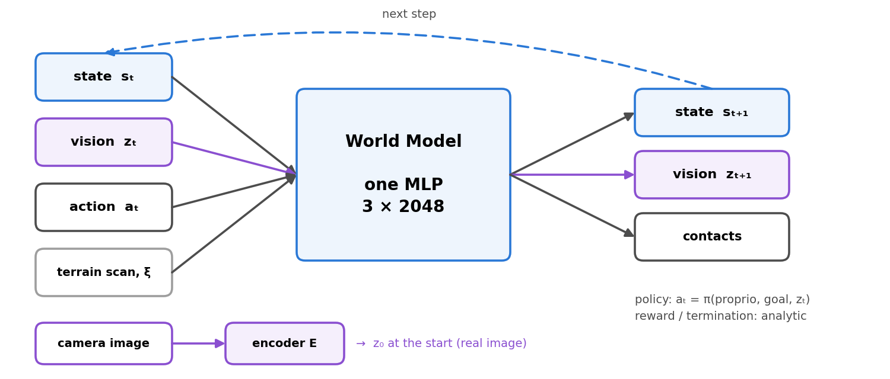

# InstinctMJ · SuperMimic

[](https://github.com/mujocolab/mjlab)
[](https://github.com/google-deepmind/mujoco_warp)
[](https://docs.python.org/3/)
[](https://github.com/project-instinct/instinct_rl)

This branch trains the G1 perceptive shadowing parkour policy (`Instinct-Perceptive-Shadowing-G1-*`, depth camera) with
**SuperMimic**: the simulator only collects data, one differentiable world model predicts the robot state and the visual latent of
the policy's depth encoder, and the policy is trained by backpropagation through 32-step imagined rollouts. No PPO. InstinctMJ is
the `mjlab` port of [InstinctLab](https://github.com/project-instinct/InstinctLab) ([Project-Instinct](https://project-instinct.github.io/)).



One RTX 3090, 1024 environments: **97% success** on the 10 motions of the released dataset (diveroll, knee climb onto a 50 cm
step, jump-sit, roll vault) after 8000 iterations (3.2 h). Method, results and configuration:
[src/instinct_mj/rl/supermimic/README.md](src/instinct_mj/rl/supermimic/README.md).

## Installation

```bash
curl -LsSf https://astral.sh/uv/install.sh | sh   # if uv is not installed
uv sync
```

- Python 3.10–3.13, Linux x86_64.
- `mjlab 1.6.0` must be next to this directory as `../mjlab` (installed editable from that path).
- `instinct_rl 1.0.2` is installed from the commit recorded in `uv.lock`.

## Data and weights

Download from the [SuperMimic release](https://github.com/project-instinct/InstinctMJ/releases/latest):

- `20251116_50cm_kneeClimbStep1.zip`: the dataset. Unzip into an explicit input directory and pass it
  with `--motion-folder`; configuration imports have no personal/default dataset path.
- The trained policy checkpoint, its ONNX export and the world-model state (to resume training).

## Usage

```bash
# train
uv run instinct-train Instinct-Perceptive-Shadowing-G1-v0 --num-envs 1024
# evaluate (success rate per motion)
uv run python -m instinct_mj.scripts.supermimic.evaluate --checkpoint <run>/model_<it>.pt --motion-folder ~/Datasets/20251116_50cm_kneeClimbStep1 --num-envs 128
# web viewer (viser)
uv run python webplay_supermimic.py <run>/model_<it>.pt
# play + ONNX export
uv run instinct-play Instinct-Perceptive-Shadowing-G1-Play-v0 --checkpoint-file <run>/model_<it>.pt --viewer none --export-onnx True
```

Runs are written to `logs/instinct_rl/g1_perceptive_shadowing/`.

## Acknowledgements

This work builds on **SuperMimic** (Liao et al., CoRL 2026), whose method this branch follows, and on
[**supermimic_vibed**](https://github.com/zita-ch/supermimic_vibed) by Chong Zhang (ETH Zurich, MIT License), the open
reproduction from which the world model, replay buffer, rotation utilities and training loop were adapted. Many thanks to the
authors of both. This branch is not affiliated with the SuperMimic authors.

```bibtex
@misc{liao2026supermimic,
  title         = {SuperMimic: Scaling Humanoid Whole-Body Control with One Differentiable World Model},
  author        = {Liao, Qiayuan and Shao, Yiyang and Long, Junfeng and Zakka, Kevin and Horowitz, Roberto and Abbeel, Pieter and Sreenath, Koushil},
  year          = {2026},
  eprint        = {2610.28480},
  archivePrefix = {arXiv},
  primaryClass  = {cs.RO},
  note          = {CoRL 2026},
  url           = {https://arxiv.org/abs/2610.28480}
}

@misc{zhang2026supermimicvibed,
  title        = {supermimic\_vibed: an open reproduction of SuperMimic},
  author       = {Zhang, Chong},
  year         = {2026},
  howpublished = {\url{https://github.com/zita-ch/supermimic_vibed}}
}
```

## License

[CC BY-NC 4.0](LICENSE): no commercial use. The adapted mjlab 1.6 reset/step lifecycle retains its
[Apache 2.0 attribution and license](LICENSES/mjlab-Apache-2.0.txt). Contributions: see [CONTRIBUTING.md](CONTRIBUTING.md) and
[CONTRIBUTOR_AGREEMENT.md](CONTRIBUTOR_AGREEMENT.md).

Checkpoints trained outside InstinctMJ are not compatible: the joint order comes from the MJCF and differs from IsaacLab.

### Explicit shadowing runtime inputs

Flat and perceptive task configurations are importable without selecting or reading a dataset. Supply native
motion buffers (including a `MotionBufferCfg.class_type` implementation), or an explicit motion folder, through
`instinct_mj.tasks.shadowing.factory.make_shadowing_env_cfg`. The existing registry and its task IDs are unchanged:

```python
from instinct_mj.tasks.shadowing.factory import make_shadowing_env_cfg
from instinct_mj.tasks.registry import load_env_cls

cfg = make_shadowing_env_cfg(
    "Instinct-Perceptive-Shadowing-G1-v0",
    motion_folder="/data/current-motions", terrain_metadata="/data/current-motions/metadata.yaml",
    num_envs=4, physics_dt=0.005, decimation=4,
)
env = load_env_cls("Instinct-Perceptive-Shadowing-G1-v0")(cfg=cfg, device="cuda:0")
```

The factory also accepts `robot` with its matching `robot_model_path`, a native `terrain` configuration,
`reference_frame_interval_s`, and explicit native-buffer `sampling` settings. It does not infer a sampler from
the number of motion files. MotionReferenceManager owns resets and reference time; its read-only `elapsed_time`
returns that per-environment clock. The shared native G1 asset and its kinematic model use the real `torso_link`
free root. `instinct-train` and `instinct-play` accept `--motion-folder` and optional `--terrain-metadata` for
ordinary folder inputs. One-motion task IDs require an explicitly supplied one-motion source; they never write
selection files or silently change start/bin settings because of dataset size.

`InstinctRlVecEnvWrapper` owns the initial reset by default. Pass `reset_on_init=False` when the caller already
owns it. Observation reads use reset/step caches, without another noise draw or history append. Optional
`clip_actions` clamps submitted actions; `processed_depth(noisy=True/False)` copies the native processed noisy or
clean camera image without sensing again. `refresh_observations_after_state_write(env_ids=...)` owns physical
sensor/history refresh after an explicit state write, without resetting motion assignments or reference time.

Native environments expose `add_physics_step_callback(callback(env, physics_dt))` after each real scene tick and
`add_terminal_callback(callback(env, terminated, truncated))` after endpoint-forward/termination evaluation and
before reward, events and auto-reset. `add_observation_callback(callback(env, env_ids))` observes the single native
observation computation after publication; an empty reset selection does not compute. All return an idempotent
unsubscribe callable. Retained callback data must
be cloned. Camera sensing keeps its normal post-step phase: capture terminal depth with `auto_reset=False`, read
the step cache, then explicitly reset done worlds. A zero-time endpoint refresh is not a physics sample.

The sole `InstinctRlEnv.step/reset` implements the pinned mjlab 1.6 lifecycle explicitly; it does not replace
scene or manager instance methods. Class extension points separate actual substeps, fresh endpoint preparation,
termination and observation publication. Partial resets retain unselected issued observations and scope native
history/delay backfills; native stateless noise still draws a full batch once. Endpoint preparation always runs,
even without passive observers. Native post-event/reset forwarding and one post-step sensing pass remain.

CPU contract checks: `python -m pytest -q tests/test_runtime_contracts.py tests/test_runtime_lifecycle.py`. The separate
`tests/native/check_runtime_callbacks.py` diagnostic requires a provisioned native execution environment and fresh
output root; CPU checks do not establish physical callback/contact accuracy or learned skill retention.

`env.terrain_placement` copies actual environment/tile origins in world meters.
`env.terrain_heightmap(resolution=..., bounds=...)` exports the compiled physical terrain's
height grid as `heights[y,x]`, `origin=[x0,y0]`, meter resolution and a per-cell validity mask.
It uses native geometry raycasts, not a separate terrain model or hidden height-field arrays.
Infinite planes require explicit finite XY bounds; a top-down grid does not represent overhangs.

Motion-matched terrain metadata may describe exact native axis-aligned primitives instead of a mesh file:
`collision_primitives` is a nonempty list of `{name, type, size, pos}` entries. Types are `plane` or `box`;
`size` uses MuJoCo half-extents (plane dimensions are visual), and `pos` is in the input-origin frame.
Names must be unique, sizes positive and all coordinates finite. This mode requires
`use_input_origin_frame=True`, cannot also declare `terrain_file`, and bypasses mesh approximation/CoACD.
An infinite plane may occur only once in the generated physical terrain, not once per tile.
Tile placement and reference-origin matching still belong to the ordinary native terrain generator.
Use primitive planes/boxes when those are the intended physical surfaces: a coarse decomposition of a wide,
thin mesh can alter its collision surface. Verify compiled geometry, not just the source mesh or its rendering.

Downstream production deployments may pin this fork with an external jointly resolved dependency lock;
that deployment lock, not the donor's development `uv.lock`, controls the installed environment.
