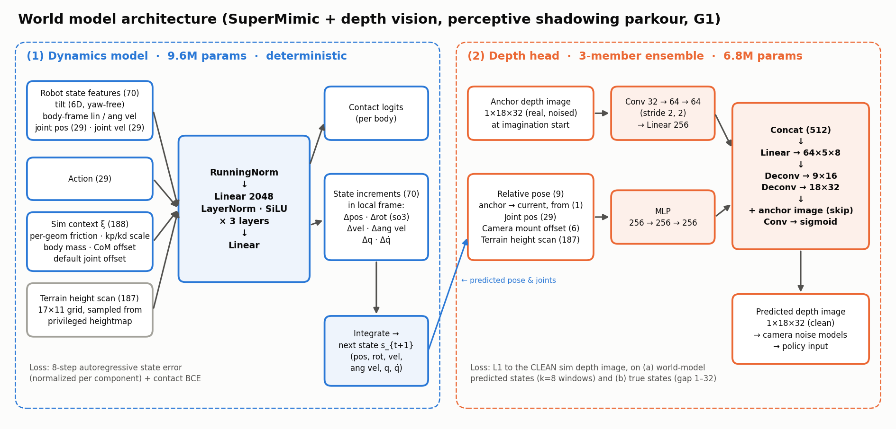
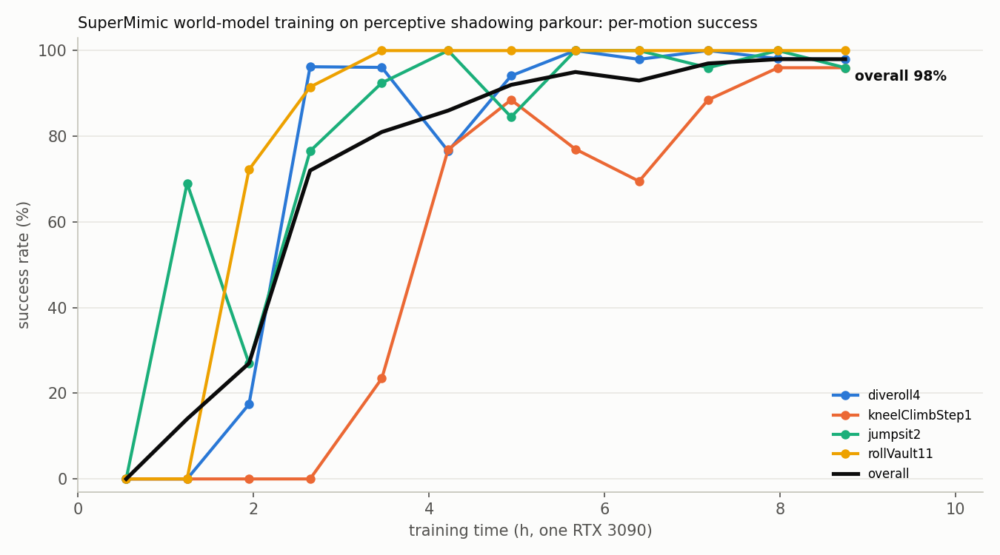

# SuperMimic world-model training for perceptive shadowing parkour (G1)

This package trains the **depth policy of `Instinct-Perceptive-Shadowing-G1-v0` purely inside a learned world model**, following
[SuperMimic: Scaling Humanoid Whole-Body Control with One Differentiable World Model](https://arxiv.org/abs/2610.28480)
(Liao et al., CoRL 2026) and its open reproduction [supermimic_vibed](https://github.com/zita-ch/supermimic_vibed) (MIT, Chong Zhang).

- **Single stage, no PPO.** The simulator only collects data. A differentiable world model is fit to that data, and the policy is
  trained by back-propagation through time (BPTT) over 32-step imagined rollouts, with analytic task rewards and a critic bootstrap.
- **Vision inside the world model.** Besides the dynamics, the world model learns the onboard depth camera: a depth head predicts the
  image the camera would see at every imagined state, so the depth policy can be trained in imagination.
- **Unchanged task, unchanged policy.** The simulator is the existing perceptive shadowing task (all domain randomization, camera
  noise and resets). The policy is the task's own network (`EncoderActorCritic` with the Conv2d depth encoder), and checkpoints are
  saved in the stock `OnPolicyRunner` format, so the existing Play task and ONNX export load them without any change.



## Results

One RTX 3090, 1024 environments, dataset `20251116_50cm_kneeClimbStep1` (10 motions on 5 terrains: diveroll, knee climb onto a 50 cm
step, jump-sit, roll vault).



Evaluation uses the Play setting (each motion from its first frame, no pushes, camera noise on) with the three tracking terminations
of the training task kept on. One episode per environment, 12–13 episodes per motion (6–7 for iterations 2000 and 4000). An episode succeeds if the whole motion is
completed without any termination.

| Iteration | Training time | Success | Completion | Link pos error | Joint pos error |
|---|---|---|---|---|---|
| 2000 | 1.2 h | 14% | 49% | 0.057 m | 0.153 rad |
| 4000 | 2.6 h | 72% | 81% | 0.058 m | 0.167 rad |
| 8000 | 5.7 h | 95% | 97% | 0.045 m | 0.140 rad |
| 12000 | 8.7 h | 98% | 98% | 0.042 m | 0.121 rad |

Per motion at iteration 12000: diveroll4 (4 terrains) 92–100%, rollVault11 100% / 100%, jumpsit2 92% / 100%,
kneelClimbStep1 92% / 100% (with wall / without wall).

This run used the code before the failure head was added. To reproduce it with the current code, add
`--agent.no-fail-head --agent.wm-failure-frac 0 --agent.wm-holdout-envs 0`.

## Method

### Training loop

```
for each iteration:
    1. collect   run the current policy (+ action noise) in the task env for ~2.5 steps (UTD 0.4), store transitions
    2. fit WM    10 minibatches of k=8-step autoregressive windows: dynamics + contact + depth (+ failure) losses
    3. policy    from real buffered states, imagine 32 steps with the frozen world model; analytic reward and soft
                 termination on the imagined states, critic bootstrap after 32 steps; maximize the return by BPTT
    4. critic    regress GAE(λ) targets computed on the imagined transitions
```

The first 500 iterations only fit the world model. Optimizers, learning rates (2e-4 with cosine decay), gradient clipping
(norm 1.0, plus element-wise 0.1 for the policy), γ = 0.99, λ = 0.95 and the update-to-data ratio follow SuperMimic.

### World model

**(1) Dynamics model** (9.6M parameters, deterministic). The SuperMimic MLP (3 × 2048, LayerNorm, SiLU) predicts the frame-local
state increments of the root (`torso_link`) and the joints, which are integrated into the next state, plus per-body contact logits.

| Input | Size |
|---|---|
| Heading- and position-invariant state: tilt (6D), body-frame linear/angular velocity, joint positions, joint velocities | 70 |
| Action | 29 |
| Episode-constant simulation context ξ: per-geom friction, kp/kd scales, body masses, torso CoM offset, default joint offsets | 188 |
| Terrain height scan (17 × 11 grid, sampled from a heightmap ray-cast once from the terrain) | 187 |

Loss: per-component normalized state error over 8-step autoregressive windows, plus contact BCE.

**(2) Depth head** (ensemble of 3, 6.8M parameters). A learned renderer of the camera's processed depth image (1 × 18 × 32). It
encodes the **real** depth image at the start of the imagination (anchor) with a small CNN, and the root pose relative to the anchor,
the joint positions (self-occlusion), the randomized camera mount offset and the terrain scan with an MLP. A transposed-convolution
decoder with a skip connection from the anchor outputs the image. It is trained with an L1 loss against the **clean** simulator image,
both on states predicted by the dynamics model (k = 8 windows) and on true states with random gaps of 1–32 steps.

**(3) Failure head** (optional, on by default). A Dreamer-style continue predictor on the privileged critic features, trained on
real terminations from the buffer (including world-model-predicted states). In imagination it is combined with the analytic soft
termination: `d = 1 − (1 − d_analytic)(1 − p_fail)`. It was added after the world model was found to be over-optimistic in the knee
climb phase. 25% of each world-model batch is drawn from windows close to a real termination.

### Policy and imagination

- The policy observation in imagination is assembled in exactly the format and order of the task's `policy` observation group:
  reference commands (joint position/velocity, position, rotation, 10 future frames, with the task's noise), the depth image, and
  8 steps of proprioception history with the task's noise.
- Imagination step 0 uses the real buffered image. From step 1 on, the depth head predicts the clean image, which then goes through
  the same camera noise models as the real camera before the policy sees it. Each imagined rollout uses one random ensemble member.
  The predicted image is fed to the policy with stop-gradient by default (`--agent.depth-grad` enables gradients).
- Rewards and terminations are analytic re-implementations of the task's terms (Gaussian tracking of base and links, action rate,
  joint limits, applied torque limits, undesired contacts via the learned contact probabilities). Terminations are sigmoid-softened.
- The critic (MLP 256-128) uses privileged features: invariant state, tracking errors, ξ, goal and terrain scan.

### Simulator side

- The environment runs with `auto_reset=False`. After each step the runner reads the pre-reset state, applied action, contacts,
  rewards and clean depth image, then resets finished environments explicitly. This keeps the terminal transition in the buffer.
- The task's own reset sampling (adaptive motion bins), domain randomization and terminations are used unchanged.
- The camera noise models that are commented out in the task config (depth contour, artifacts, range-based stereo noise, Gaussian
  blur, stereo too close) are enabled by the training script (`--depth-noise`, default on), together with the task's camera mount
  randomization. The task files are not modified.

## Usage

### Install

The package adds two console entry points in `pyproject.toml`; reinstall the package (`uv pip install -e .`) to get them. Without
reinstalling, use `python -m instinct_mj.scripts.supermimic.train` and `python -m instinct_mj.scripts.supermimic.evaluate`.

### Train

```bash
instinct-supermimic-train --motion-folder ~/Xyk/Datasets/20251116_50cm_kneeClimbStep1 --num-envs 1024 \
    --agent.save-interval 1000 --agent.max-iterations 40000
```

Resume (loads the policy checkpoint and its world-model sidecar; the replay buffer is refilled):

```bash
instinct-supermimic-train --motion-folder ... --resume logs/instinct_rl/g1_perceptive_shadowing/<run>/model_<it>.pt
```

When resuming a checkpoint that was saved before the failure head existed, add `--resume-init-new-heads`.

### Evaluate

```bash
instinct-supermimic-eval --checkpoint <run>/model_12000.pt --motion-folder ~/Xyk/Datasets/20251116_50cm_kneeClimbStep1 --num-envs 128
instinct-supermimic-eval --run-dir <run> --watch --motion-folder ...          # evaluate every new checkpoint
instinct-supermimic-eval --checkpoint ... --motion-folder ... --video-only    # one video per motion
```

Results go to `<run>/eval/` (`results.csv`, `eval_<it>.json`, `videos/`). Every motion of the dataset gets at least 3 episodes.

### Visualize

```bash
python webplay_supermimic.py [<run>/model_<it>.pt]     # viser web viewer, default: newest checkpoint of the run
```

Because checkpoints use the stock format, the regular `instinct-play` on `Instinct-Perceptive-Shadowing-G1-Play-v0` and
`--export-onnx` also work (point the Play config to the same dataset).

### Outputs

Runs are written to `logs/instinct_rl/g1_perceptive_shadowing/<timestamp>_supermimic/`:

- `model_<it>.pt`: policy, policy optimizer and policy normalizer in the stock `OnPolicyRunner` format.
- `supermimic_state_<it>.pt`: world model, depth heads, failure head, critic, their optimizers and training state (for `--resume`).
- `params/`: the env config, the stock agent config and the SuperMimic config.
- TensorBoard events: world-model losses, depth error vs. open-loop horizon, imagined vs. real termination rates, policy and critic
  losses, simulator reward and episode statistics.

## Configuration

Set any field on the command line as `--agent.<field>` (underscores become hyphens, e.g. `--agent.pi-batch 2048`).

| Group | Field | Default | Meaning |
|---|---|---|---|
| Collection | `seed` | 42 | Random seed |
| | `buffer_steps` | 1000 | Replay buffer length (vectorized env steps) |
| | `utd` | 0.4 | Updates per vectorized simulator step |
| | `warmup_steps` | 64 | Simulator steps collected before any update |
| | `goal_frames` | 10 | Future reference frames in the goal (task value) |
| | `hist` | 8 | Proprioception history length (task value) |
| World model | `wm_window` | 8 | Window length k of the multi-step fit |
| | `wm_batches` | 10 | World-model gradient steps per iteration |
| | `wm_batch` | 2048 | Windows per world-model batch |
| | `wm_failure_frac` | 0.25 | Fraction of each batch drawn from windows just before a real termination |
| | `wm_failure_horizon` | 16 | Steps before a termination within which a window counts as a failure window |
| | `wm_holdout_envs` | 0.1 | Fraction of envs held out from world-model training (calibration diagnostics) |
| | `wm_only_iters` | 500 | World-model-only iterations at the start |
| Depth head | `depth_ensemble` | 3 | Number of depth heads |
| | `depth_windows` | 512 | Windows per batch that also train the depth heads |
| | `depth_pairs` | 512 | (anchor, target) pairs per batch for the true-state term |
| | `depth_loss_weight` | 5.0 | Weight of the depth loss |
| | `depth_grad` | False | Back-propagate the policy loss through the predicted image |
| Failure head | `fail_head` | True | Use the learned failure head in imagination |
| | `fail_head_warmup_iters` | 300 | Iterations after creation before it affects the policy |
| | `fail_windows` | 512 | Windows per batch that train the failure head |
| | `fail_clip` | 0.95 | Upper clip of the failure probability in imagination |
| | `fail_pos_weight` | 1.0 | BCE positive weight |
| Policy / critic | `horizon` | 32 | Imagination horizon H |
| | `pi_batch` | 1024 | Imagination starts per policy update |
| | `gamma` | 0.99 | Discount |
| | `lam` | 0.95 | GAE λ for the critic targets |
| | `action_noise` | 0.1 | Gaussian action noise during collection |
| | `critic_epochs` | 5 | Critic epochs per policy update |
| | `critic_minibatches` | 4 | Critic minibatches per epoch |
| | `no_critic` | False | Ablation: no critic and no bootstrap term |
| Schedule | `max_iterations` | 320000 | Total iterations |
| | `lr` | 2e-4 | Initial learning rate |
| | `lr_decay_iters` | 250000 | Cosine decay length |
| | `lr_final_ratio` | 0.03 | Final learning rate as a fraction of `lr` |
| Performance | `amp` | `bf16` | Autocast dtype of the MLPs (`bf16` or `none`) |
| | `compile` | True | `torch.compile` the world-model functions |
| | `compile_policy` | True | `torch.compile` the imagination step, rewards/terminations and critic features |
| | `policy_autocast` | False | bf16 autocast of the policy in imagination only |
| | `checkpoint_imagination` | False | Gradient checkpointing of every imagination step (less memory) |
| | `heightmap_resolution` | 0.05 | Terrain heightmap resolution (m) |
| | `heightmap_cache_dir` | `~/.cache/instinct_mj/supermimic_heightmaps` | Heightmap cache |
| Logging | `save_interval` | 2000 | Iterations between checkpoints |
| | `log_interval` | 50 | Iterations between logs |

Other arguments of `instinct-supermimic-train`: `--task` (`Instinct-Perceptive-Shadowing-G1-v0`), `--num-envs` (1024),
`--motion-folder`, `--device` (`cuda:0`), `--depth-noise / --no-depth-noise` (on), `--resume`, `--resume-init-new-heads`,
`--log-root` (`logs/instinct_rl`).

Arguments of `instinct-supermimic-eval`: `--motion-folder` (required), `--checkpoint` or `--run-dir` (with `--every`, `--watch`,
`--watch-poll-s`, `--watch-max-idle-s`), `--num-envs` (64), `--min-episodes-per-motion` (3), `--depth-noise` (on),
`--episode-length-s` (30), `--seed` (7), `--video`, `--video-only`, `--video-motions`, `--video-size`, `--video-distance`,
`--video-elevation`, `--video-azimuth`.

## Files

| File | Content |
|---|---|
| `config.py` | `SuperMimicRunnerCfg` |
| `runner.py` | `SuperMimicRunner`: collection, world-model fitting, imagination/BPTT, critic, logging, save/load |
| `networks.py` | `WorldModel`, `DepthHead` / `DepthEnsemble`, `FailureHead`, `Critic`, `RunningNorm` |
| `mdp.py` | Analytic task heads: rewards, hard/soft terminations, policy observation assembly, critic features |
| `depth.py` | `DepthPipeline`: clean/noised processed depth images, camera noise models applied to predicted images |
| `sim.py` | Reads state, contacts, context ξ and camera mount offset from the mjlab env |
| `motion_lib.py` | Reference motion library built from the task's loaded motion buffers |
| `kinematics.py` | Differentiable forward kinematics (batched by tree level) |
| `terrain.py` | Terrain heightmap (ray-cast once, cached on disk) and differentiable height scan |
| `buffer.py` | GPU replay buffer (windows, imagination starts, depth pairs, failure-weighted sampling) |
| `rotations.py` | Rotation utilities |
| `scripts/supermimic/train.py`, `evaluate.py` | Training and evaluation entry points |
| `tests/supermimic/` | Parity checks, failure diagnosis and benchmarks |
| `webplay_supermimic.py` (repo root) | viser web viewer |

## Verification

| Script | Checks |
|---|---|
| `tests/supermimic/check_analytic_heads.py` | Analytic heads against the running env: reference indexing (exact), FK (≤ 2.3e-5), reward terms (≤ 2e-6 on the same state), terminations on both sides of every threshold (no mismatch), policy observation assembly (≤ 1.4e-5), camera offset reconstruction, terminal states. Fails with a non-zero exit code. |
| `tests/supermimic/check_play_load.py` | Loads a checkpoint through the stock Play path, runs a headless rollout and exports ONNX. |
| `tests/supermimic/check_policy_update_parity.py` | The compiled imagination/BPTT path matches the eager one (loss and actor gradients). |
| `tests/supermimic/diagnose_failure.py` | Per-step failure analysis of one motion and imagined-vs-real termination rates. |
| `tests/supermimic/bench_*.py` | Speed and parity benchmarks of FK, noise models and the runner. |

## Performance

On an RTX 3090 with 1024 environments, one iteration takes about 2.3–2.6 s (about 0.4 it/s) with 13.4 GB peak GPU memory. Most of
the time is spent fitting the depth heads (convolutions over 8-step windows for 3 ensemble members). `--agent.checkpoint-imagination`
recomputes imagination activations in the backward pass and is expected to roughly halve the peak memory, at about 10% more time.

## Known limitations

- The terrain heightmap has a single surface, so overhangs are not represented in the dynamics input.
- Depth prediction errors grow with the imagination horizon, and regions outside the anchor view are hallucinated.
- The analytic heads use the post-step state, while the env managers see body poses one physics substep older, so rewards and
  terminations differ slightly near thresholds.
- Issues of the existing task, not fixed here:
  - The task's `height_scanner` only includes geom group 0, but the terrain is in group 2, so the critic `height_scan` observation
    is constant. It is kept so that stock Play can load the checkpoints; the world model uses its own heightmap.
  - `TerrainMotion._safe_motion_resampling` keeps the old start time when it replaces a motion without terrain, which can index past
    the end of the replacement motion for some seeds (seed 42 is safe).

## Differences from SuperMimic

| | SuperMimic | This package |
|---|---|---|
| Task | Motion tracking on flat ground | Perceptive motion tracking on terrain |
| Dynamics input | State, action, context (33) | Adds a terrain height scan; context extended to 188 |
| Outputs | State increments | Adds contact logits and a failure head |
| Observations | Proprioception | Adds a learned depth-image head (observation model) |
| Policy | MLP encoder/decoder | The task's own depth policy network |
| Reset sampling | Return-based bins | The task's adaptive motion bins |
